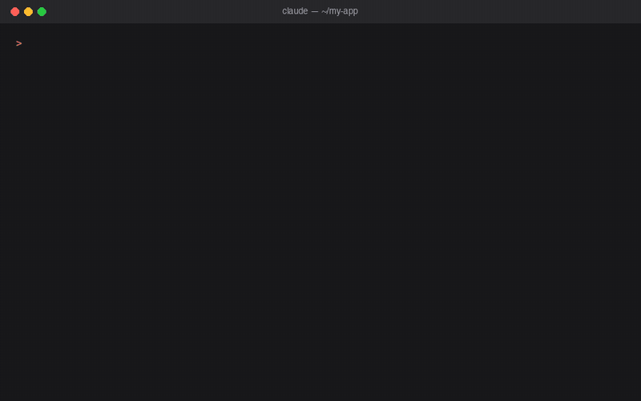

# Basecoat MCP Server

[](https://www.npmjs.com/package/basecoat-ui-mcp)
[](https://www.npmjs.com/package/basecoat-ui-mcp)
[](https://basecoatui.com/)
[](https://registry.modelcontextprotocol.io/v0/servers?search=io.github.Sorbh/basecoat-ui-mcp)
[](https://opensource.org/licenses/MIT)

Give your AI assistant the full [Basecoat UI](https://basecoatui.com/) component library (the shadcn/ui look in plain HTML + Tailwind, no React), so it writes correct Basecoat markup instead of guessing class names.

**Kept in sync with Basecoat releases.** Basecoat 1.0.2 shipped with breaking API changes; this MCP was updated to it the same day.

[](https://cursor.com/en/install-mcp?name=basecoat-ui&config=eyJjb21tYW5kIjoibnB4IiwiYXJncyI6WyIteSIsImJhc2Vjb2F0LXVpLW1jcCJdfQ==)
[](https://insiders.vscode.dev/redirect/mcp/install?name=basecoat-ui&config=%7B%22command%22%3A%22npx%22%2C%22args%22%3A%5B%22-y%22%2C%22basecoat-ui-mcp%22%5D%7D)



## Story

While building my hobby project — turning old devices into a [Digital Photo Frame](https://github.com/Sorbh/digital-photo-frame) — I struggled with UI components. I wanted to use [Basecoat CSS](https://basecoatui.com/), the HTML port of [ShadCN UI](https://ui.shadcn.com/), but there was no MCP server to easily pull components and docs into AI-assisted coding.

So I built one.  
This is my first MCP server, and it’s here to make working with Basecoat (and ShadCN-style components) effortless for everyone. Feedback and contributions are welcome!

---

A Model Context Protocol (MCP) server that provides programmatic access to [Basecoat CSS](https://basecoatui.com/) components and their usage documentation. This server allows AI assistants to help developers build HTML interfaces using the Basecoat CSS framework.

## Features

- **Basecoat 1.0.2**: All markup follows the 1.0 API (`class="btn" data-variant="outline"`, `.field`, method-based JS).
- **90+ Component Variants**: Buttons, fields, input groups, cards, dialogs, command menus, drawers, charts and more.
- **Usage Documentation**: Implementation guides for 30 components, including JS requirements and 0.x migration notes.
- **Setup Scripts**: CDN links for any style pack (Vega, Nova, Maia, Lyra, Mira, Luma, Sera, Rhea) and the theme script.
- **Search & Discovery**: Find components by name or category.
- **Accessibility Ready**: All components include ARIA attributes and semantic HTML.

## Quick Start

No install needed: every client runs the server with `npx`.

### Claude Code

```bash
claude mcp add basecoat-ui -- npx -y basecoat-ui-mcp
```

### Claude Desktop

Add to `claude_desktop_config.json`:

```json
{
  "mcpServers": {
    "basecoat-ui": {
      "command": "npx",
      "args": ["-y", "basecoat-ui-mcp"]
    }
  }
}
```

### Cursor

Click **Install in Cursor** above, or add to `~/.cursor/mcp.json`:

```json
{
  "mcpServers": {
    "basecoat-ui": {
      "command": "npx",
      "args": ["-y", "basecoat-ui-mcp"]
    }
  }
}
```

### VS Code (GitHub Copilot)

Click **Install in VS Code** above, or add to `.vscode/mcp.json`:

```json
{
  "servers": {
    "basecoat-ui": {
      "command": "npx",
      "args": ["-y", "basecoat-ui-mcp"]
    }
  }
}
```

### Windsurf

Add to `~/.codeium/windsurf/mcp_config.json`:

```json
{
  "mcpServers": {
    "basecoat-ui": {
      "command": "npx",
      "args": ["-y", "basecoat-ui-mcp"]
    }
  }
}
```

### Codex CLI

Add to `~/.codex/config.toml`:

```toml
[mcp_servers.basecoat-ui]
command = "npx"
args = ["-y", "basecoat-ui-mcp"]
```

### Other MCP clients

Run `npx -y basecoat-ui-mcp` as a stdio server.

### Try it

Ask your assistant something like:

> Build a sign-up page with Basecoat: a card with GitHub/Google buttons, email and password fields, and a dark mode toggle.

It will call `get_setup`, pull the matching components and usage docs, and return HTML that uses the real Basecoat 1.0 API.

## Local Development

```bash
git clone https://github.com/Sorbh/basecoat-ui-mcp.git
cd basecoat-ui-mcp
npm install
```

Point your client at the local copy:

```json
{
  "mcpServers": {
    "basecoat-ui": {
      "command": "node",
      "args": ["/path/to/basecoat-ui-mcp/server.js"]
    }
  }
}
```

## Available Tools

| Tool | Description | Parameters |
|------|-------------|------------|
| `get_component` | Get HTML code for a specific component variant | `name`: Component name (e.g., "button-outline", "field", "command"). Prefix with a category to disambiguate (e.g., "layout/pagination") |
| `list_components` | List all available components organized by category | None |
| `get_usage` | Get usage documentation for a component | `component`: Component name (e.g., "button", "combobox"). Variant names fall back to their base doc ("button-primary" → "button") |
| `get_setup` | Get Basecoat CSS setup code with CDN links | `style` (optional): vega (default), nova, maia, lyra, mira, luma, sera, rhea |
| `get_theme_script` | Get theme switcher script for dark/light mode | None |
| `search_components` | Search for components by name or category | `query`: Search term (e.g., "button", "form", "navigation") |
| `get_category` | Get all components in a specific category | `category`: combine, feedback, forms, interactive, layout, navigation |

## Component Categories

### Forms
- **Button**: default, secondary, outline, ghost, link, destructive, sizes, icon, with-icon, loading
- **Button Group**: horizontal, vertical
- **Field / Fieldset**: label, description, invalid state, grouped fields
- **Input / Input Group**: basic, with-label, invalid, with icon, with button
- **Select**: native select, JS select
- **Checkbox, Radio Group, Switch**: with labels and descriptions
- **Slider, Textarea, Label, Form container**

### Navigation
- **Tabs**, **Accordion**, **Breadcrumb**, **Sidebar**

### Feedback
- **Alert**: default, success, error
- **Alert Dialog**, **Dialog**: confirmation and modal forms
- **Badge**: primary, secondary, destructive, outline
- **Toast**, **Empty**, **Progress**, **Spinner**

### Interactive
- **Command**: inline and dialog palettes
- **Combobox**: input-first searchable select
- **Dropdown Menu**, **Popover**, **Tooltip**
- **Drawer** (beta): bottom and side
- **Theme Switcher**

### Layout
- **Card**, **Avatar**, **Item**, **Kbd**, **Scroll Area**
- **Skeleton**, **Table**, **Pagination**
- **Chart** (beta)

### Combine
Composed examples: chat, login, settings, interactive pagination.

## Upgrading from 1.x of this MCP

Version 2.0.0 of this MCP targets Basecoat 1.0.2, which has breaking changes from Basecoat 0.3.x:

- Variant classes became data attributes: `btn-outline` → `class="btn" data-variant="outline"`, `btn-sm-icon` → `data-size="icon-sm"`.
- The `.form` wrapper was removed; wrap each label and control in `<div class="field">`.
- Document events (`basecoat:toast`, `basecoat:sidebar`, `basecoat:theme`) were replaced by methods: `toaster.toast()`, `sidebar.toggle()`, `window.basecoat.theme.toggle()`.
- `dialog-alert` was renamed to `alert-dialog`.

If your project still has 0.x markup, load Basecoat's compatibility stylesheet after Basecoat while you migrate (`@import "basecoat-css/compat";`). See `style-guide.md` for the full migration guide.

## Directory Structure

```
basecoat-mcp/
├── components/           # HTML component files
│   ├── combine/         # Composed page examples
│   ├── feedback/        # Alerts, badges, dialogs, toasts
│   ├── forms/           # Buttons, fields, inputs, selects
│   ├── interactive/     # Command, combobox, dropdowns, tooltips
│   ├── layout/          # Cards, tables, avatars, items
│   └── navigation/      # Tabs, accordion, sidebar
├── usage/               # Usage documentation (same categories)
├── scripts/             # Setup and theme scripts
├── style-guide.md       # Full Basecoat 1.0 style and migration guide
├── server.js            # MCP server implementation
├── package.json
└── README.md
```

Categories are read from disk, so adding a folder under `components/` or `usage/` is enough to expose it.

## About Basecoat CSS

Basecoat CSS is a comprehensive CSS framework that provides:
- Accessible, semantic components
- Dark/light theme support  
- Tailwind CSS integration
- JavaScript-enhanced interactions
- Mobile-responsive design

Learn more at [basecoatui.com](https://basecoatui.com)

## License

MIT License - see LICENSE file for details.

## Contributing

1. Fork the repository
2. Create a feature branch: `git checkout -b feature/amazing-feature`
3. Make your changes following our coding standards
4. Test your changes thoroughly
5. Commit with clear messages: `git commit -m 'Add amazing feature'`
6. Push to your branch: `git push origin feature/amazing-feature`
7. Open a Pull Request

## Support

- **Issues**: [GitHub Issues](https://github.com/sorbh/basecoat-ui-mcp/issues)


---

<p align="center">
Built with ❤️ by Claude Code - Monitored & Prompted by Saurabh K. Sharma
</p>
